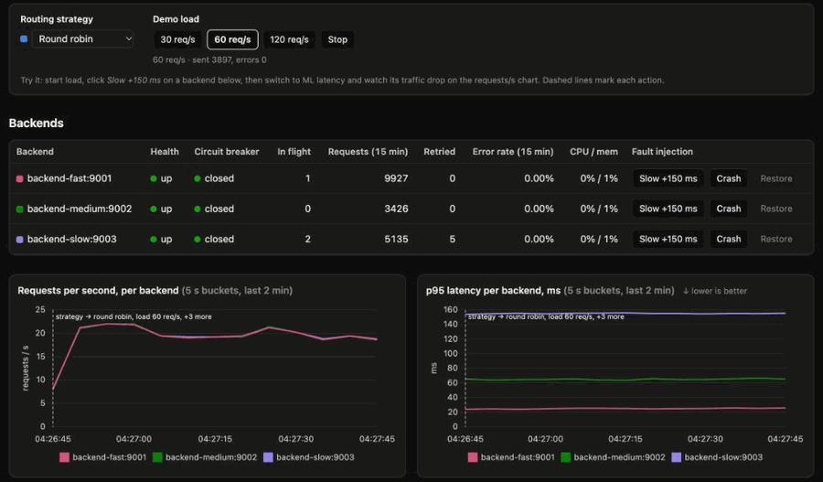
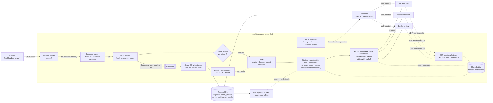

# adaptive-lb: an HTTP load balancer from raw sockets, with ML routing

A multithreaded HTTP load balancer written from scratch in Python (raw `socket` + `threading`, no frameworks) with health checks, circuit breakers and retries, comparing round robin, least connections, an ML latency model and a multi-armed bandit in 80 measured runs, with a live dashboard to break things and watch it adapt.



*The dashboard under 60 req/s. Under round robin, slowing `backend-medium` by 150 ms pushes its p95 to ~210 ms while it keeps getting a third of the traffic. Switching to ML latency moves traffic to the fast backend within seconds. Crashing that one opens its circuit breaker, and retries keep the client error count at 0.*

## Results

**Headline:** when backends differ in speed, routing on predicted latency cut **p95 latency by 82% vs round robin and 81% vs least connections** (31 ms vs 170 / 166 ms), and held p95 at **33 ms during a 6× traffic spike where round robin reached 3.8 s**. The tail tells more: in the spike, **ML's p99 was 52 ms vs 4.3 s for round robin (−99%) and 169 ms for least connections (−69%)**, and after a sudden 10× slowdown, where p95 called the adaptive strategies a tie, **ML's p99 was 47 ms vs 328 ms for least connections (−86%)**. Where ML did *not* help: at the median (p50) every adaptive strategy is within ~3 ms of the others, after the slowdown least connections matched it at p95 (within noise), and with identical backends (a crash) ML was slightly worse (p95 39.6 vs 38.8 ms).

Latency in ms, mean ± standard deviation over 5 runs of 30 s each (80 runs in total). **Bold** = clear winner at that percentile, beating every other strategy by more than the noise. Percentiles are computed per run from all completed (non-5xx) requests (Postgres `percentile_cont`); p99 rests on the slowest ~1% of them (~27 requests per 30 s run at ~90 req/s, ~39 in the spike), so it is noisier than p95: see ML's ± 15 ms.

| Scenario | Strategy | p50 | p95 | p99 | Avg |
|---|---|---:|---:|---:|---:|
| **Unequal servers** (20 / 60 / 150 ms, 90 req/s) | Round robin | 69.3 ± 1.7 | 170.0 ± 2.2 | 173.3 ± 2.5 | 86.8 ± 1.5 |
|  | Least connections | 30.1 ± 2.6 | 166.3 ± 1.9 | 171.6 ± 2.2 | 59.8 ± 2.0 |
|  | ML latency | 27.8 ± 1.7 | **31.3 ± 2.6** | **52.1 ± 14.7** | 28.2 ± 1.4 |
|  | Bandit | 27.7 ± 1.7 | 70.4 ± 2.0 | 167.9 ± 2.3 | 33.8 ± 1.6 |
| **Sudden slowdown** (one of 3 × 30 ms → 300 ms at 15 s) | Round robin | 38.0 ± 1.6 | 2,333 ± 175 | 3,121 ± 181 | 321.8 ± 20.3 |
|  | Least connections | 37.1 ± 1.2 | 43.6 ± 2.5 | 327.6 ± 1.1 | 49.3 ± 1.2 |
|  | ML latency | 37.7 ± 1.2 | 41.9 ± 2.1 | **46.7 ± 1.4** | 38.6 ± 1.2 |
|  | Bandit | 36.9 ± 1.1 | 41.5 ± 1.6 | 320.2 ± 5.4 | 43.3 ± 2.4 |
| **Traffic spike** (unequal backends, 30 → 180 req/s at 10 s) | Round robin | 67.3 ± 0.2 | 3,840 ± 338 | 4,336 ± 273 | 748.2 ± 65.5 |
|  | Least connections | 27.3 ± 0.1 | 164.0 ± 0.3 | 169.0 ± 0.3 | 55.7 ± 0.3 |
|  | ML latency | 26.1 ± 0.1 | **33.2 ± 2.5** | **51.6 ± 15.0** | 26.9 ± 0.6 |
|  | Bandit | **25.9 ± 0.1** | 68.0 ± 1.0 | 165.2 ± 0.3 | 32.0 ± 0.6 |
| **Server crash** (one of 3 × 30 ms killed at 15 s) | Round robin | 36.1 ± 0.1 | 38.9 ± 0.2 | 41.0 ± 1.1 | 36.0 ± 0.1 |
|  | Least connections | 36.2 ± 0.1 | 38.8 ± 0.1 | 40.6 ± 0.9 | 36.0 ± 0.1 |
|  | ML latency | 36.7 ± 0.1 | 39.6 ± 0.3 | 42.7 ± 1.9 | 36.6 ± 0.2 |
|  | Bandit | 36.1 ± 0.1 | 38.9 ± 0.2 | 42.1 ± 2.4 | 36.0 ± 0.1 |

Full results (min–max per percentile, errors, throughput, traffic share per backend): [`experiments/results/comparison_results.md`](experiments/results/comparison_results.md).

**Links:** [static results page](https://bansil08.github.io/AI-Adaptive-Load-Balancer-/) (GitHub Pages, from [`docs/`](docs/index.html)) · [live demo GIF](docs/demo.gif) · [`CONCEPTS.md`](CONCEPTS.md): every feature mapped to the OS / networks / DBMS / ML concept behind it, plus interview questions

> Built as a learning project by a 2nd-year B.Tech student to show OS, computer networks, DBMS, system design and ML fundamentals in one working system. Every number here was measured on one laptop (Apple Silicon, 8 cores, macOS, Python 3.14) and comes with the command that produced it.

## Quick start

Needs only Docker (Desktop, with Compose v2):

```bash
git clone https://github.com/Bansil08/AI-Adaptive-Load-Balancer-.git adaptive-lb && cd adaptive-lb
docker compose up -d --build        # or: make up
open http://127.0.0.1:5050          # the dashboard (or paste the URL into a browser)
```

That starts Postgres, the load balancer, three backends (20 / 60 / 150 ms) and the dashboard; the schema is applied and the trained model is included, so nothing else is needed. On the dashboard, click **60 req/s** to start load, **Slow +150 ms** on a backend, then switch the strategy to **ML latency**, or run `make demo` (= `make up` + 60 req/s of background load). Try `curl -i localhost:8080/` for a single request through the LB, and `curl -s localhost:8081/backends` for its admin API. `make down` stops everything (the database is kept in a Docker volume).

To run the tests or the experiments you also need Python 3.11+:

```bash
make setup         # .venv with the pinned dependencies, and .env from .env.example
make test          # 415 tests, about a minute (needs `make up` for the database tests)
make experiments   # the full comparison: 4 strategies x 4 scenarios x 5 runs (~42 min) -> experiments/results/
make static        # export the newest full batch to docs/ (the static results page)
```

`make help` lists every target. The experiments start their own backends and load balancers as local processes, so the Docker stack can stay up, though for clean timings leave its demo load off. `make quick-experiment` is a one-minute version whose results go to `experiments/results/partial/`, so it never overwrites the committed ones. To rebuild the model from scratch, run `make baselines` (~13 min, the training data), then `make train`.

Other measurements, each writing a report with its exact setup to `experiments/results/`: `python -m experiments.benchmark_concurrency` (thread pool vs thread-per-connection, ~25 min), `benchmark_pooling` (connection pooling, ~5 min), `demo_failover` (kill and restart a backend under traffic, ~45 s), `benchmark_db` (batched inserts, `EXPLAIN ANALYZE` with and without indexes, retention, ~5 min), and `make overhead` (the LB's own cost per request, ~15 s). Every LB setting is in [`lb.toml`](lb.toml) (running from source) or [`lb.docker.toml`](lb.docker.toml) (Docker), with a comment on each.

## Architecture



| Component | What it does |
|---|---|
| **Listener + bounded queue + worker pool** (`lb/server.py`, `lb/bounded_queue.py`) | One thread accepts TCP connections and puts them on a bounded queue; a fixed pool of workers serves them (producer-consumer). When the queue is full the listener stops accepting, so overload costs latency, not unbounded threads. |
| **HTTP parser + proxy** (`lb/http_parser.py`, `lb/proxy.py`) | Parses HTTP/1.1 by hand (TCP is a byte stream: read to the blank line, then exactly `Content-Length` bytes), strips hop-by-hop headers, adds `X-Forwarded-For`, forwards over a pooled keep-alive connection with timeouts, and answers `502` / `503` / `504` when no backend gives a usable answer. |
| **Router** (`lb/router.py`) | Keeps the candidate backends (healthy, circuit not open, not draining) and leases one per request, so a backend being removed can drain its in-flight requests first. |
| **Shared stats** (`lb/stats.py`, `lb/rwlock.py`) | Per backend: requests in flight, a recent-latency average and the latest heartbeat, behind a readers-writers lock (read on every routing decision, written on every request). |
| **Health checks + heartbeats** (`lb/health.py`, `lb/heartbeat.py`, `backend/agent.py`) | A thread probes every backend (TCP connect, then `GET /health`); each backend's agent reports CPU, memory and active connections over UDP every second. |
| **Request log** (`lb/db_writer.py`, `db/`) | Workers drop a record on a queue without waiting; one writer thread inserts batches of up to 200 per transaction. The dashboard, the experiments and the ML training data all read it through SQL views. |
| **Admin API** (`lb/admin.py`) | A separate port: inspect backends, switch strategy at runtime, add or drain-and-remove a backend. Changes need the `X-Admin-Token`. |
| **Dashboard** (`dashboard/`) | Live requests/s and p50 / p95 / p99 per backend (a toggle picks one), health and circuit state, the headline result and per-scenario winners, and the controls: strategy, fault injection per backend, background demo load, with each action marked on the charts. |

### One request, step by step

1. **Accept.** The listener's `accept()` returns a connected socket (the kernel has already done the TCP three-way handshake) and puts it on the bounded queue; if all workers are busy and the queue is full, the listener waits and new connections wait in the kernel's listen backlog.
2. **Parse.** A worker reads the request by hand. Malformed or ambiguous requests (conflicting lengths, request-smuggling patterns) get a `400`; a client too slow to send its whole request in 3 s gets a `408`.
3. **Rate limit.** A token bucket per client IP allows bursts but caps the sustained rate; an empty bucket gets `429` with `Retry-After`.
4. **Choose.** The router narrows to healthy, breaker-closed backends and asks the strategy (below).
5. **Forward.** Over a pooled connection, with connect and read timeouts. No answer: `502` (refused, reset, garbage) or `504` (too slow); `GET`/`HEAD` are then retried on a different backend with exponential backoff; `POST` never is.
6. **Learn and reply.** The outcome updates the backend's in-flight count and latency average, its circuit breaker and the bandit's reward window; the response goes back and the socket is closed with a lingering close, so a pending RST can't destroy the reply.
7. **Log.** One non-blocking `put()` of a log record; the writer thread stores it in the next batch.

## Routing strategies

| Strategy | How it chooses | Strength | Weakness (measured) |
|---|---|---|---|
| **Round robin** (`lb/strategies/round_robin.py`) | The next backend in turn (a counter under a lock). | Simple, perfectly even. | Ignores load and speed: a backend that can't keep up with its third builds a queue (p95 2.3–3.8 s). |
| **Least connections** (`least_connections.py`) | The backend with the fewest requests in flight. A slower backend holds requests longer (Little's law), so it gets fewer. | Reacts within a second to a slowed backend, with no model. | Balances *load*, not speed: the 150 ms backend still gets ~15%, so it sets the p95. |
| **ML latency** (`ml_latency.py`) | Predicts each backend's response time with a linear regression on in-flight requests, CPU, memory and recent average latency (trained offline from the request log, `ml/`), and picks the lowest. | Sends ~99% to the fast backend: p95 −81% vs least connections with unequal backends. | Never explores, so it can't notice a backend that has recovered from being slow; ~34 µs per decision; no gain when backends are equal. |
| **Bandit** (`bandit.py`) | Epsilon-greedy: with probability 0.1 a random backend (explore), otherwise the best mean reward (−latency) over each backend's last 50 requests (exploit). | Learns online, needs no training, adapts to change. | Exploration permanently sends ~3–4% to each slow backend, which lands in the p95 (68–70 ms) and sets the p99 (165–168 ms). |

Both ML strategies run inside a guard (`lb/strategies/guarded.py`): a missing model, an unknown feature (no heartbeat yet), an exception or a decision slower than 2 ms means least connections decides that request, and the fallback is logged and counted (0.84% of ML-routed requests in the final batch).

## Reliability features

| Feature | Behaviour | Configured in |
|---|---|---|
| **Health checks** | Every 1–2 s: TCP connect, then `GET /health` must return 200. Down after 2 failures in a row, up after 2 passes (hysteresis, so one lost probe doesn't flap a backend). | `[health]` |
| **Circuit breaker** | Per backend, from real requests: 5 consecutive failures → OPEN (skipped) for 5 s → HALF_OPEN (2 trial requests) → CLOSED. Reacts faster than health checks; health checks notice backends that get no traffic. | `[circuit_breaker]` |
| **Retries** | `GET`/`HEAD` only (idempotent), on a backend not tried yet, with exponential backoff (50 ms, 100 ms, ...), at most 2. Measured: with a backend killed under load, 0 of 3,167 client requests failed (3 of 3,156 without retries). | `[retries]` |
| **Timeouts** | Client: the whole request within 3 s. Backend: 2 s to connect, 30 s to answer. | `[timeouts]` |
| **Rate limiting** | Token bucket per client IP; `429` + `Retry-After` when empty. | `[rate_limit]` |
| **Graceful shutdown** | SIGTERM: stop accepting, finish in-flight requests, flush the request log. | `[concurrency]` |
| **Fault injection** (demo) | Each backend can be slowed, crashed (closes every connection without answering) or restored from the dashboard, behind `X-Admin-Token`. | `docker-compose.yml` |

## Features by subject

**Operating systems**
- Producer-consumer with a hand-written **bounded queue** (one mutex, two condition variables) feeding a **fixed thread pool**, measured against thread-per-connection.
- **Readers-writers lock** with writer preference for the shared per-backend stats; a documented **global lock order** to rule out deadlock.
- **Graceful shutdown** on SIGINT/SIGTERM: stop accepting, drain in-flight requests, flush the DB queue. The signal handler only sets a flag.
- Survives file-descriptor exhaustion (`EMFILE` on `accept()`): log, back off, keep serving.
- Counting semaphore in the test backends to model limited capacity and queueing.

**Computer networks**
- **HTTP/1.1 parser and reverse proxy** on raw sockets: framing by `Content-Length`, chunked and close-delimited bodies, `Expect: 100-continue`, hop-by-hop headers, request-smuggling defences.
- **Connection pooling** with keep-alive and stale-connection detection (`MSG_PEEK`), measured against a new connection per request.
- **TCP and HTTP health checks**, **UDP heartbeats** with sequence numbers against reordering and duplicates, `502`/`503`/`504` semantics, lingering close (FIN vs RST), `TCP_NODELAY`.
- **Retries only for idempotent methods** (GET/HEAD) with exponential backoff.

**DBMS**
- 3NF PostgreSQL schema with foreign keys, CHECK constraints and soft deletes.
- **Single writer thread with batched transactions**: savepoint salvage of a bad row, reconnect with retry, and buffering through a database outage.
- **Composite indexes** proven with `EXPLAIN ANALYZE` on 1.2M rows (26–78× faster dashboard queries; a `LATERAL` "latest heartbeat before each request" join went from 10.8 s to 0.27 ms).
- **Views** for the dashboard and the ML export, one `percentile_cont` call for p50 / p95 / p99, `date_bin` for time buckets, and a batched 7-day **retention job**.

**System design**
- **Strategy pattern** for routing; **circuit breaker** (closed / open / half-open, state pattern); health-check hysteresis; **token-bucket rate limiting**; **rendezvous hashing** for sticky sessions.
- **Admin API** on a separate loopback port (control plane vs data plane), with drain-then-remove.
- **Open-loop load generator** (Poisson arrivals, no coordinated omission) and a repeatable **experiment harness**: fresh processes per run, identical seeds for every strategy, results computed in SQL.
- **Live dashboard** (Flask + Chart.js) combining Postgres history with the LB's in-memory state, with live controls (strategy switch, fault injection, demo load) and event markers.

**Machine learning**
- **Supervised latency model**: features exported with SQL exactly as the LB knew them at decision time (no leakage), **time-based train/test split**, linear regression vs decision tree vs random forest vs a "recent average" baseline, MAE reported honestly.
- **Epsilon-greedy multi-armed bandit** written by hand, with a sliding window so it adapts when a backend changes.
- **Safe fallback** to least connections on a missing model, an error, or a blown 2 ms time budget, with every fallback counted. Per-decision overhead measured.

## Experiment methodology

- **Scenarios** (`experiments/scenarios.py`): unequal servers (20 / 60 / 150 ms, 90 req/s), a sudden 10× slowdown of one of three equal backends halfway through, a traffic spike from 30 to 180 req/s, and a backend killed with SIGKILL halfway through. Every backend works on at most 8 requests at a time, so it can actually be overloaded.
- **Each run** starts fresh backend processes and a fresh LB, so no stats, pooled connections or breaker state carry over; 30 s of load; then avg / p50 / p95 / p99 latency, error rate and throughput are computed in SQL from that run's request log.
- **Open-loop load** (`experiments/load_generator.py`): Poisson arrivals sent on schedule whether or not earlier requests have answered. A closed-loop client ("send, wait, send") slows down exactly when the server does and hides the tail (coordinated omission).
- **Fairness**: every strategy gets the same seeds, so it sees the identical sequence of arrivals; the final seeds (2000–2004) are not those the model's training data came from (42–44).
- **Repeats and noise**: 5 runs per cell, reported as mean ± sample standard deviation with min–max; a winner is only named when it beats the others by more than that spread.
- **Honesty checks**: retries off during experiments (so errors show what routing did); every run's logged request count was compared with the load generator's (80 / 80 matched exactly); the model file's hash is stored with each ML run.

### What the numbers say, including where ML did not help

- **Round robin fails whenever a backend can't keep up with its third of the traffic.** After b slows to 300 ms it can finish ~25 req/s but keeps getting 30, so its queue grows for the rest of the run: p95 climbs from 40 ms to 2.3 s (the blue line above). In the spike, the slow backend's third (60 req/s) exceeds its ~51 req/s capacity: p95 reaches 3.8 s, and throughput drops 13% (113.8 vs 130 req/s) because the backlog takes extra seconds to drain. Every other strategy avoids both.
- **Least connections already captures most of the gain.** Watching in-flight counts (Little's law: a slower backend holds its requests longer) is enough to cut the slowed backend's share to ~9% within a second. In the slowdown it is within noise of both ML strategies (43.6 ± 2.5 vs 41.9 ± 2.1 ms p95). Its blind spot is speed: with unequal backends it still sends the 150 ms server 14–15% of requests, more than 5%, so the p95 *is* a slow-server answer (~165 ms).
- **ML wins where backends differ in speed.** The latency model sends 99% of traffic to the 20 ms backend, which can serve ~380 req/s, so even 180 req/s doesn't overload it. p95 falls from ~165 to 31–33 ms, about −80%. The bandit gets halfway (68–70 ms). Its ε = 0.1 exploration permanently sends 3–4% to *each* slower backend, and since those 7% of requests are slow, they land in the top 5% and set the p95. That is the cost of being able to notice change. In the slowdown timeline the same exploration shows as brief spikes: in any second where 5 or more of ~90 requests randomly land on b, that second's p95 is a 300 ms answer.
- **p99 shows what p95 hides.** A strategy that sends a slow backend between 1% and 5% of all requests gets a fine p95 and a slow p99. After the slowdown, least connections still sends b ~9% of the later traffic and the bandit ~3%; over the whole run that is 4.4% and 2.0% of requests answered in over 250 ms, so both p99s land on b's ~300 ms (328 and 320 ms) while ML, at 0.4%, stays at 47 ms. With unequal backends the bandit's exploration does the same (p95 70 ms, p99 168 ms). The median (p50) barely separates the adaptive strategies at all (within ~3 ms everywhere): they differ in the tail, not the typical request. A big p50 → p99 gap (round robin: 38 ms → 3.1 s) means some requests queue on an overloaded backend.
- **ML did not help in two scenarios at p95.** In the **slowdown** the gain over least connections (~2 ms p95) is smaller than the run-to-run spread; the average improves (38.6 vs 49.3 ms) and so does p99 (above), because ML cuts b to under 1% instead of ~9%. In the **crash**, with identical backends there is nothing to learn: ML's p95 is ~0.8 ms *worse* than round robin's, from its extra per-decision work and fallbacks. Errors (~0.2%) are the requests in flight on b when it died, or sent to it before the circuit breaker and health checks removed it. The bandit's lower 0.10% is chance: fewer of its requests happened to be in flight on b at that instant. It is not a designed advantage.
- **Why ML wins is less impressive than it looks.** The model's weights amount to "1 × recent average latency + ~3 ms per request in flight", and for normal requests it predicts no better than simply using the recent average (MAE 6.1 vs 3.3 ms under 200 ms; [`ml_training.md`](experiments/results/ml_training.md)). The gain comes from routing on *latency* rather than on load, which a non-ML rule could probably do too. That baseline was not measured, so it is the first item under Future work. The CPU and memory features added nothing (22.5 vs 22.6 ms test MAE without them), because every backend here is the same sleeping Python process.
- **Costs.** One ML routing decision takes ~34 µs vs ~4 µs for least connections ([`ml_inference.md`](experiments/results/ml_inference.md)). 510 of 60,390 ML-routed requests (0.84%) fell back to least connections. 284 of those were at the start of a run or on a killed backend (no fresh heartbeat or no latency history yet). The other 226 went over the 2 ms budget, because a thread was waiting for Python's GIL while other workers ran, not because the model was slow. The bandit fell back once in 20 runs.
- **Caveats.** The model was trained on earlier runs of these same four scenarios (Phase 5 baselines, seeds 42–44), so this is its best case. It never explores, so a backend it stops using keeps its old average and a recovery would go unnoticed. Everything ran on one laptop with artificial delays.


### Other measured results

- **Thread pool vs thread-per-connection** (50 ms backends): at 200 concurrent clients a 256-worker pool served 3,426 req/s with 257 threads, thread-per-connection 3,378 req/s with 201. At 500 clients thread-per-connection was ~9% faster (4,652 vs 4,276 req/s) but needed 437 threads against the pool's fixed 257. A 32-worker pool capped out at ~560 req/s. The pool's benefit is a hard cap on threads, not speed.
- **Connection pooling** (0 ms backends, loopback): +29–35% throughput (e.g. 7,273 vs 5,514 req/s at 8 clients) and 0.5 instead of 1,000 backend TCP handshakes per 1,000 requests; TIME_WAIT sockets on the backend ports dropped from ~14,800 to ~53.
- **Failover**: a backend SIGKILLed under ~160 req/s. With retries off, 3 of 3,156 requests failed, all in the first second. With retries on, none of 3,167 did. The restarted backend was serving again 1 s after it came back.
- **The LB's own overhead** (0 ms backend, one request at a time, new client connection each): +0.05 ms median per request with round robin, least connections or the bandit, +0.10 ms with the ML model ([`overhead_benchmark.md`](experiments/results/overhead_benchmark.md); the pooled backend connection pays for most of the extra hop).
- **Database**: batching 200 rows per transaction inserted 52,512 rows/s against 3,060 for one commit per row (17×). With Postgres stopped for 6 s under ~1,000 req/s, clients saw no errors and no slowdown, and all 20,010 requests still reached the table once it came back.

## Design decisions and trade-offs

**Thread pool instead of asyncio or thread-per-connection.** The project's point is to show the OS mechanisms (a bounded buffer, condition variables, a readers-writers lock), which `asyncio` hides. Against thread-per-connection, a fixed pool puts a hard bound on threads and memory under overload and pushes back through the kernel's listen backlog. The measured cost: each worker is tied up for the whole request, so a slow client or slow backend occupies a thread. At 500 clients thread-per-connection was 9% faster, and enough slow clients (slowloris) can stall the pool for a few seconds. `select`/`epoll` would fix that and is deliberately left out to stay at undergraduate-syllabus level.

**UDP for heartbeats, TCP for requests.** A heartbeat is a "latest value" report sent every second: if one is lost, the next replaces it, so TCP's handshake, retransmission and in-order delivery would only add cost, and a stalled TCP stream would deliver stale metrics late. Each datagram carries the agent's start time and a sequence number, so reordered or duplicated ones are dropped. A proxied request is the opposite case (every byte must arrive once, in order), so it uses TCP. The cost: UDP is trivially spoofable, so the listener binds to loopback and accepts reports only for known backends. A real deployment would sign them.

**One database writer thread with batching.** If 32 workers each inserted their own row, every request would wait on a database round trip and a commit (fsync), and 32 connections would contend for the database. Instead workers do a non-blocking `put()` and one thread writes batches of up to 200 rows per transaction: 17× the insert rate. A slow or down database never slows requests, because the queue absorbs the gap. The trade-offs: a crash of the LB loses whatever is still queued in memory, and when the queue is full (10,000 records, ~10 s of a database outage at 1,000 req/s), records are dropped and counted rather than blocking traffic. Request serving matters more than logging completeness. A failed batch is retried, so delivery is at-least-once (a retry after a lost commit acknowledgement can insert a batch twice).

**Retries only for GET and HEAD.** A retry is only safe if doing the request twice has the same effect as doing it once. If a POST's connection breaks after the backend received it, the backend may already have acted (charged a card, placed an order), and resending it would do that twice. GET and HEAD are read-only by definition, so they are retried on a *different* backend with exponential backoff, to avoid a retry storm on a struggling cluster. Only failures with no usable answer are retried: a 500 is the backend's answer and is passed through. (PUT and DELETE are idempotent too; they're left out to keep the rule simple.) The retry budget is capped at 2, so one request can't multiply load by more than 3×.

**Others.** A circuit breaker (passive, from real traffic) *and* health checks (active probes): the breaker reacts within a few failed requests, while probes notice a dead backend that gets no traffic and confirm when it has recovered. Results are computed in SQL from the request log, not from the load generator, and cross-checked against it on every run (every run matched exactly). The ML model is trained offline and only loaded by the LB, so a training bug can never take routing down: the guard falls back to least connections.

## Limitations and next steps

**The load balancer is a single point of failure.** Everything goes through one process on one machine. If it crashes, every backend is unreachable, however healthy they are, and its in-memory state (circuit breakers, stats, the bandit's learned rewards, queued log records) is lost.

The standard fix is **active-passive failover**:
- Run a second, identical LB as a hot standby on another machine. Both have the same config and both health-check the backends, so the standby's view of the backends is already warm.
- Clients connect to a **virtual IP**, not to either machine. The active LB owns it and sends a heartbeat to the standby every ~1 s (VRRP, as implemented by `keepalived`, does exactly this).
- If the standby misses N heartbeats in a row (the same hysteresis idea as the health checks), it claims the virtual IP and announces it with a gratuitous ARP, so traffic moves to it within a few seconds. Connections in flight on the dead LB are lost, and clients retry.
- The hard part is **split brain**: if only the link between the two LBs fails, both think the other is dead and both take the virtual IP. Fencing (the new active one cuts off the old one, e.g. through the switch or a cloud API) or a third tie-breaking node prevents it.
- Most state can stay local, since each LB re-learns backend health in seconds. Rate-limit buckets and sticky sessions would need shared storage (e.g. Redis) or rebuilding after failover.

Active-active (DNS round robin or anycast in front of several LBs) also scales out, but every piece of shared state then needs coordination, which is beyond this project's scope.

**Other limitations, honestly:**
- One request per client connection (no client-side keep-alive), and no TLS: the LB speaks plain HTTP.
- Each request ties up a worker thread, so slow clients can tie up the pool (see the thread-pool trade-off above).
- Python's GIL means threads don't run Python code in parallel. This is fine for an I/O-bound proxy, but it also caused most of the ML strategy's over-budget fallbacks.
- Heartbeats are unauthenticated, and the admin API and fault injection are protected only by a shared token (`ADMIN_TOKEN`) plus loopback-only ports: fine for a demo, not for production.
- Every backend is a local process sleeping for an artificial delay, so the CPU and memory heartbeat features carry no real signal, and every experiment runs on one laptop: the LB, backends, load generator and Postgres all share 8 cores.
- The latency model was trained on earlier runs of the same four scenarios (with different random seeds), which is its best case.

### Next steps

- **A non-ML latency baseline**: route to the lowest "recent average + k × in-flight" score. The model's weights are close to exactly that, so this is the obvious test of whether the ML adds anything.
- **Active-passive LB pair** with a virtual IP, as described above.
- **ML that explores**: the supervised strategy never re-tries a backend it has stopped using, so it can't notice a recovery. Mixing in a little exploration (or retraining online from the request log) would fix that. A bandit with UCB or Thompson sampling instead of a fixed ε would explore less once it is confident.
- **Event-driven I/O** (`selectors`) for the client side, so slow clients stop costing a thread each; client keep-alive; TLS termination.
- **Realistic backends**: real CPU-bound work and Docker CPU limits, so CPU and memory carry signal, and runs across several machines.
- Authenticated heartbeats (HMAC) and an authenticated admin API.

## Repository layout

| Path | What's there |
|------|--------------|
| `lb/` | The load balancer: listener + thread pool (`server.py`), HTTP parser, proxy, router, strategies, health checks, circuit breaker, heartbeats, rate limiter, connection pool, DB writer, admin API |
| `backend/` | Test backend (configurable delay, jitter, capacity) and its UDP heartbeat agent |
| `db/` | `schema.sql` (3NF tables, indexes) and `queries.sql` (views for the dashboard and the ML export) |
| `ml/` | `export_data.py` (SQL → features), `train.py` (time split, four models, MAE), `evaluate.py` (unseen runs, overhead) |
| `experiments/` | Load generator, scenarios, experiment runner, plots, benchmarks; `results/` holds the measured reports and charts |
| `dashboard/` | Flask app (live data, controls, demo load, headline logic in `summary.py`) and the Chart.js page |
| `docs/` | The static results page for GitHub Pages (`index.html`; data exported by `make static`) and `demo.gif` |
| `lb.toml`, `lb.docker.toml` | LB configuration for running from source and in Docker Compose |
| `scripts/` | `init_db.py` (apply the schema), `retention.py`, `seed_db.py` (synthetic data for the DB benchmark) |
| `tests/` | pytest suite: unit tests plus tests against a throwaway Postgres database |
| `CONCEPTS.md` | Feature → file → CS concept map, lock order, `EXPLAIN ANALYZE` before/after, interview questions |
| `PROJECT_SPEC.md`, `phase-*.md` | The original specification and the instructions for each build phase |
