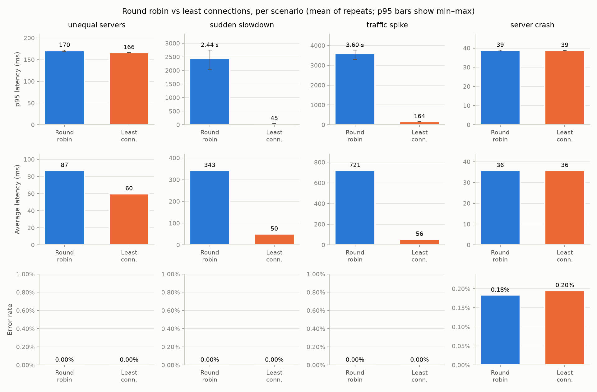

# adaptive-lb: AI-Adaptive Load Balancer

An HTTP load balancer built on raw sockets and threads in Python. It routes traffic across backends of different speeds using round robin, least connections and two ML-based strategies, performs health checks and failover, logs every request to PostgreSQL, and includes an experiment harness that compares the strategies under different traffic scenarios.

> **Status:** Phase 6 (two ML strategies, a supervised latency model and an epsilon-greedy bandit, both falling back to least connections, compared with the baselines on all four scenarios). See `PROJECT_SPEC.md` for the full plan and `CONCEPTS.md` for the feature → CS concept map.

## Prerequisites

- Python 3.11+
- Docker Desktop (with Docker Compose v2)

## Setup

```bash
# 1. Python environment
python3 -m venv .venv
source .venv/bin/activate
pip install -r requirements.txt

# 2. Database credentials (edit the password in .env)
cp .env.example .env

# 3. Start PostgreSQL 16 and wait until it is healthy
docker compose up -d
docker compose ps          # STATUS should say "(healthy)"
# Postgres is exposed on host port 5433 (set in .env) to avoid clashing
# with a locally installed Postgres on the default 5432.

# 4. Create the tables, indexes and views
python scripts/init_db.py  # creates whatever is missing; safe to re-run
# After editing schema.sql, use --reset (drops all data): IF NOT EXISTS
# never alters a table that already exists.

# 5. Run the tests
pytest
```

To stop the database: `docker compose down` (data is kept in the `pgdata` volume; `docker compose down -v` deletes it).

## Run the load balancer

```bash
# Postgres + three test backends: fast (20 ms) :9001, medium (60 ms) :9002, slow (150 ms) :9003
docker compose up -d

# The LB reads backends, port, strategy and timeouts from lb.toml
python -m lb.server

# In another terminal: round robin rotates fast -> medium -> slow
for i in 1 2 3 4 5 6; do curl -s localhost:8080/; done
```

Stop a backend (`docker compose stop backend-slow`): GET requests that were on their way to it are retried on another backend, and within a few seconds the health checks (and the circuit breaker) take it out of rotation; `docker compose start backend-slow` and it rejoins after two passed health checks. A backend slower than `backend_read` in `lb.toml` returns `504 Gateway Timeout`; POSTs are never retried, so they can see `502`/`504`.

### Reliability features (Phase 3, all configured in `lb.toml`)

| Feature | Section | What it does |
|---------|---------|--------------|
| Health checks | `[health]` | Every `interval` s: TCP connect, then `GET /health` must answer 200. Down after `unhealthy_threshold` failures in a row, up after `healthy_threshold` passes. |
| Circuit breaker | `[circuit_breaker]` | Per backend, from real requests: `failure_threshold` consecutive failures → OPEN (skipped) for `cooldown` s → HALF_OPEN (`half_open_trials` test requests) → CLOSED. |
| UDP heartbeats | `[heartbeat]` | Backends started with `--heartbeat 127.0.0.1:9100` report CPU %, memory % and active requests every second. |
| Connection pooling | `[pool]` | Up to `size` idle keep-alive connections per backend are reused; `size = 0` opens a new connection per request. |
| Retries | `[retries]` | GET/HEAD only, on a different backend, with exponential backoff; never POST. |
| Rate limiting | `[rate_limit]` | Token bucket per client IP: `burst` requests at once, `rate` per second sustained; then `429` with `Retry-After`. |
| Sticky sessions | `sticky_sessions` | Same client IP → same backend (rendezvous hashing). Off by default. |
| Admin API | `[admin]` | Separate port, loopback only (no auth). See below. |

```bash
curl -s localhost:8081/backends                                          # health, circuit, stats, heartbeats, pool
curl -s -X POST localhost:8081/backends -d '{"address": "127.0.0.1:9004"}' # joins after passing health checks
curl -s -X DELETE localhost:8081/backends/127.0.0.1:9004                 # drains in-flight requests, then removes
```

### Request log in PostgreSQL (Phase 4)

With `[database] enabled = true` (as in `lb.toml`), every request, every health check and every heartbeat is written to Postgres by one background writer thread, in batches (`batch_size` records or `flush_interval_ms`, whichever comes first, one transaction per batch). Workers never wait for the database: if it is slow or down they keep serving and the queue absorbs the gap (`GET /backends` on the admin port shows the writer's counters). On shutdown the queue is flushed.

```bash
docker exec -it adaptive-lb-postgres psql -U adaptive_lb -d adaptive_lb   # then, for example:
SELECT * FROM dashboard_latency_per_minute;    -- p95 / avg per server per minute, last 15 min
SELECT * FROM dashboard_error_rate;            -- 5xx rate per server (+ requests no backend served)
SELECT * FROM dashboard_requests_per_server;   -- request and retry counts per server
SELECT * FROM training_data LIMIT 5;           -- each request + the latest heartbeat before it (Phase 6)

python scripts/retention.py            # delete rows older than 7 days, 5000 per transaction (run from cron)
python -m experiments.benchmark_db     # ~5 min, in a throwaway database: inserts, indexes, retention
```

The benchmark results (batched vs single-row inserts, `EXPLAIN ANALYZE` with and without the indexes on 1.2M rows, batched vs single retention DELETE) are in `experiments/results/db_benchmark.md`.

### Experiments: round robin vs least connections (Phase 5)

```bash
docker compose up -d postgres && python scripts/init_db.py   # results are stored in Postgres
python -m experiments.run_experiments                         # ~28 min: 4 strategies x 4 scenarios x 3 repeats, seed 42
python -m experiments.run_experiments --strategies round_robin least_connections   # Phase 5 baselines only
python -m experiments.run_experiments --scenarios traffic_spike --repeats 1 --duration 12   # a quick look
python -m experiments.plot_results                           # redraw the charts for the latest batch
```

Each run starts fresh backends (local processes on ports 19001-19003) and a fresh load balancer tagged with the run's `experiment_runs.id`, sends open-loop load with `experiments/load_generator.py`, fires the scenario's events (slow a backend down, kill one), then computes avg / p95 latency, error rate and throughput in SQL into `run_results`. Results: `experiments/results/baseline_results.md`, `baseline_bars.png`, `timeline_sudden_slowdown.png`, `timeline_server_crash.png`.

The scenarios (`experiments/scenarios.py`): unequal servers (20 / 60 / 150 ms), a sudden 10x slowdown of one backend halfway through, a traffic spike from 30 to 180 req/s, and a backend killed halfway through. Every backend processes at most 8 requests at a time (`--capacity 8`), so it can be overloaded. Set `strategy = "least_connections"` in `lb.toml` to use it outside the experiments.

#### Baseline results (measured)

Mean of 3 runs per cell, 30 s each, seed 42; p95 min–max in brackets. Full table: `experiments/results/baseline_results.md`.

| Scenario | Strategy | Avg latency | p95 latency | Errors | Throughput | Requests sent to each backend |
|---|---|---:|---:|---:|---:|---|
| Unequal servers | Round robin | 87.2 ms | 170 ms [169–172] | 0% | 90.4 req/s | fast 33% / medium 33% / slow 33% |
| | Least connections | **59.9 ms** | 166 ms [166–166] | 0% | 90.6 req/s | fast 56% / medium 29% / slow 15% |
| Sudden slowdown | Round robin | 343 ms | 2,438 ms [2,026–2,744] | 0% | 81.1 req/s | a 33% / b 33% / c 33% |
| | Least connections | **50.3 ms** | **45 ms** [44–46] | 0% | **90.1 req/s** | a 40% / b 21% / c 39% |
| Traffic spike | Round robin | 721 ms | 3,596 ms [3,299–3,761] | 0% | 113.8 req/s | fast 33% / medium 33% / slow 33% |
| | Least connections | **55.5 ms** | **164 ms** [164–164] | 0% | **129.4 req/s** | fast 59% / medium 28% / slow 14% |
| Server crash | Round robin | 35.8 ms | 39 ms | 0.18% | 90.6 req/s | a 42% / b 17% / c 42% |
| | Least connections | 35.8 ms | 39 ms | 0.20% | 90.6 req/s | a 42% / b 17% / c 42% |



Why each strategy behaved as it did:

- **Unequal servers.** Round robin gives the 150 ms server a third of the traffic regardless. Least connections sees that server holding its requests longer (more in flight, Little's law) and sends it only 15%, so the average drops 31%. The p95 hardly moves: 15% is still more than 5% of requests, so the 95th percentile is still a slow-server response (~150–165 ms). To move the p95, the slow server would have to get under 5%, which only a latency-aware strategy would do.
- **Sudden slowdown.** After b becomes 10× slower it can finish only ~25 req/s, but round robin keeps sending it 30 req/s, so b's queue grows for the rest of the run and p95 climbs from 40 ms to over 3 s (`timeline_sudden_slowdown.png`). Least connections sees b's in-flight count rise and cuts its share from 33% to ~9% within about a second, so the queue never forms. Its average (50 ms) is *above* its p95 (45 ms): the 300 ms responses are ~4.5% of requests, fewer than 5%, so they raise the average but sit above the p95.
- **Traffic spike.** At 180 req/s, round robin's third (60 req/s) is more than the slow server's ~51 req/s capacity, so its queue grows for the 20 s the spike lasts. Least connections spreads by load (59 / 28 / 14%), no backend is overloaded, and p95 stays at 164 ms.
- **Server crash.** No difference. About 5 requests per run fail either way: those in flight on b when it dies, and the few sent to it before the circuit breaker (5 consecutive failures) and the health checks (2 failed probes, ≤ 2 s) take it out; after that both strategies use the two survivors. Least connections' known weakness (a dead backend refuses connections in ~1 ms, so it looks idle) is cut short by the breaker. Retries were off on purpose; with them on, no client sees an error (see the failover demo).
- **Throughput** (successful requests ÷ the time taken to serve them) falls with round robin exactly where its queues form: 81.1 vs 90.1 req/s in the sudden slowdown (−10%) and 113.8 vs 129.4 req/s in the spike (−12%), because round robin needed 33.6 s and 34.2 s to finish 30 s of arrivals while its backlog drained. Elsewhere both serve the full offered rate (~90.5 req/s). No request was lost in any scenario except the crash: the cost of a poor strategy here is latency and the extra seconds of backlog, not dropped requests.

### ML strategies (Phase 6)

```bash
python -m ml.export_data --batch baseline-20261022T030347Z   # training data from the Phase 5 runs -> ml/data/training_data.csv
python -m ml.train                                           # fits 4 models, saves the best to ml/models/latency_model.joblib
python -m ml.evaluate --data ml/data/comparison_baselines.csv   # MAE on later runs + per-decision overhead
python -m experiments.run_experiments                        # all four strategies on all four scenarios
```

Set `strategy = "ml_latency"` or `"bandit"` in `lb.toml` (sections `[ml_latency]` and `[bandit]`; `epsilon` is configurable) to use them outside the experiments.

- **`ml_latency`** (`lb/strategies/ml_latency.py`): for each healthy backend, predicts its response time from active connections, CPU %, memory % and recent average latency, and picks the lowest. The model is trained offline from the request log (`ml/export_data.py` rebuilds each feature as the LB knew it at that moment, `ml/train.py` splits by time). Saved model: linear regression, test MAE 22.6 ms vs 60.7 ms for "predict the recent average" (the depth-8 tree scored 77.7, the forest 80.5); on 24 later runs it never saw, 14.7 ms vs 31.3 ms. Details: `experiments/results/ml_training.md`, `ml_inference.md`.
- **`bandit`** (`lb/strategies/bandit.py`): epsilon-greedy, no training. With probability 0.1 a random healthy backend (explore), otherwise the one with the best mean reward (−latency) over its last 50 requests (exploit). A failed request counts as 1000 ms.
- **Safety** (`lb/strategies/guarded.py`): if the model is missing, a feature is unknown, the prediction throws or takes over 2 ms, the request goes to least connections and a counted WARNING is logged.

#### All four strategies (measured)

Batch `comparison-20261022T155233Z`: all four strategies in one batch, same seeds, 3 runs of 30 s per cell. Full table: `experiments/results/comparison_results.md`.

| Scenario | Strategy | Avg latency | p95 latency | Errors | Requests sent to each backend | Fallbacks |
|---|---|---:|---:|---:|---|---:|
| Unequal servers | Round robin | 85.3 ms | 168 ms | 0% | fast 33 / medium 33 / slow 33% | – |
| | Least connections | 57.9 ms | 165 ms | 0% | fast 57 / medium 28 / slow 15% | – |
| | ML latency | **27.3 ms** | **30 ms** | 0% | fast 99 / medium 1 / slow 1% | 1.56% |
| | Bandit | 32.7 ms | 69 ms | 0% | fast 93 / medium 4 / slow 4% | 0% |
| Sudden slowdown | Round robin | 336 ms | 2,388 ms | 0% | a 33 / b 33 / c 33% | – |
| | Least connections | 49.5 ms | 50 ms [45–57] | 0% | a 40 / b 21 / c 39% | – |
| | ML latency | **38.7 ms** | **41 ms** [40–43] | 0% | a 41 / b 18 / c 41% | 1.42% |
| | Bandit | 43.8 ms | **41 ms** [40–42] | 0% | a 47 / b 15 / c 38% | 0% |
| Traffic spike | Round robin | 728 ms | 3,638 ms | 0% | fast 33 / medium 33 / slow 33% | – |
| | Least connections | 56.1 ms | 165 ms | 0% | fast 58 / medium 28 / slow 14% | – |
| | ML latency | **27.1 ms** | **33 ms** | 0% | fast 99 / medium 0 / slow 0% | 0.67% |
| | Bandit | 31.9 ms | 68 ms | 0% | fast 93 / medium 3 / slow 3% | 0% |
| Server crash | Round robin | 36.0 ms | 38.8 ms | 0.18% | a 42 / b 17 / c 42% | – |
| | Least connections | 36.1 ms | 39.0 ms | 0.18% | a 42 / b 17 / c 42% | – |
| | ML latency | 36.8 ms | 40.0 ms | 0.20% | a 41 / b 17 / c 41% | 1.21% |
| | Bandit | 36.1 ms | 39.3 ms | 0.15% | a 27 / b 19 / c 55% | 0.02% |


Where ML wins, ties and loses, and why:

- **Wins: unequal servers and the traffic spike.** p95 drops from ~165 ms (least connections) to 30–33 ms. Least connections balances *load*, so the 150 ms server still gets 14–15% of requests and the p95 is one of its answers. The model knows the 20 ms server stays fastest until it has many requests queued, so it sends it 99%. The fast server can do ~380 req/s, so even 180 req/s doesn't overload it. The bandit gets most of the way (p95 68 ms), but it pays for exploration: ε = 0.1 sends ~3–4% to *each* slow server permanently, which puts slow answers back into the top 5%. That's the price of being able to notice change.
- **Small win: the sudden slowdown.** p95 41 ms for both ML strategies vs 50 ms for least connections. After b slows down, least connections still sends it ~9% (it only sees in-flight counts), so every second's p95 stays near 300 ms (`comparison_timeline_sudden_slowdown.png`). ML cuts b to ~1% within a second because its recent-average feature jumps. The bandit had a one-second spike right at the change (b was often its greedy choice, and its window needed a few slow answers to turn), then settled at ~3%. Most of the gain over round robin (2.4 s → 50 ms) comes from simply using load information, which least connections already does.
- **Ties: the crash.** All four lose ~5 requests per run, those in flight on b or sent to it in the moment before the circuit breaker and health checks remove it. Nothing learned helps with a process that dies instantly.
- **Costs.** One ML decision takes ~35 µs vs ~4 µs for least connections (`ml_inference.md`), invisible next to 20–300 ms backends. Fallbacks were 0.7–1.6% of ML requests: 145 of 421 had a feature missing (no fresh heartbeat or no latency history yet, mostly in a run's first second), and 276 were decisions that took over 2 ms, a thread waiting for Python's GIL while other workers ran, not a slow model. The bandit fell back twice in 12 runs.
- **Caveats.** The model was trained on these same four scenarios (earlier runs), so this is the best case for it. It has no exploration: a backend it stops using keeps its old average, so it wouldn't notice a recovery. Its linear weights also rely on CPU/memory features that are close to noise here (the forest gave them 0.2% importance). On a mixed workload or after a recovery, the bandit's exploration or least connections' simplicity may well be the better choice.

### Failover demo

```bash
python -m experiments.demo_failover   # ~45 s; kills a backend under traffic and restarts it, twice (retries off / on)
```

Prints a per-second table (requests served by each backend, errors, the killed backend's health and circuit state) and saves it to `experiments/results/failover_demo.md`.

Connections are served by a fixed pool of worker threads fed by a bounded queue; `[concurrency]` in `lb.toml` sets `workers`, `queue_size` and `shutdown_timeout`. Ctrl+C (SIGINT) or `kill` (SIGTERM) shuts down gracefully: new connections are refused, in-flight requests finish (for up to `shutdown_timeout` seconds), then the process exits. A second Ctrl+C exits immediately. `--thread-per-connection` switches to the Phase 1 design for comparison.

Known limitation: a worker is busy for the whole time a client takes to send its request, so slow or idle clients can tie up the pool. `client` in `[timeouts]` (3 s) bounds the *whole* request, not each `recv()`, which stops a byte-at-a-time "slowloris" client from holding a worker forever, but ~32 such clients can still stall a 32-worker pool for a few seconds. Fixing that fully needs `select`/`epoll`, which this project deliberately leaves out; the per-client-IP rate limit (`[rate_limit]`) caps how many requests one IP can send.

### Benchmark: thread pool vs thread-per-connection

```bash
python -m experiments.benchmark_concurrency   # ~25 min (waits for TIME_WAIT between runs); starts its own backends and LBs
```

Results (with the exact setup) are saved to `experiments/results/concurrency_benchmark.md` and `.json`.

### Benchmark: connection pooling vs a new connection per request

```bash
python -m experiments.benchmark_pooling   # ~5 min; starts its own backends and LBs
```

Results are saved to `experiments/results/pooling_benchmark.md` and `.json`.

Without Docker, start the backends as processes instead (one terminal each):

```bash
python -m backend.app --port 9001 --name fast   --delay-ms 20  --heartbeat 127.0.0.1:9100
python -m backend.app --port 9002 --name medium --delay-ms 60  --heartbeat 127.0.0.1:9100
python -m backend.app --port 9003 --name slow   --delay-ms 150 --heartbeat 127.0.0.1:9100
```

After pulling Phase 3, rebuild the backend image once (it now includes `psutil`): `docker compose build`.

## Repository layout

| Path | Purpose |
|------|---------|
| `lb/` | The load balancer: listener + thread pool, HTTP parser, proxy, strategies, health checks, rate limiter, DB writer |
| `backend/` | Test backend servers with configurable delay, plus a UDP heartbeat agent |
| `db/` | `schema.sql` (3NF schema) and `queries.sql` |
| `ml/` | Training-data export (`export_data.py`), model training (`train.py`) and evaluation / overhead (`evaluate.py`) |
| `experiments/` | Load generator, scenarios, experiment runner and plotting |
| `dashboard/` | Flask + Chart.js dashboard |
| `scripts/` | Helper scripts (`init_db.py`) |
| `lb.toml` | Load balancer config: backends, listen port, strategy, timeouts |
| `phase-*.md` | The instructions for each build phase |
| `tests/` | pytest suite |

## Architecture, results and analysis

Added in later phases.
