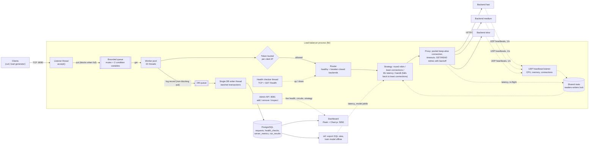
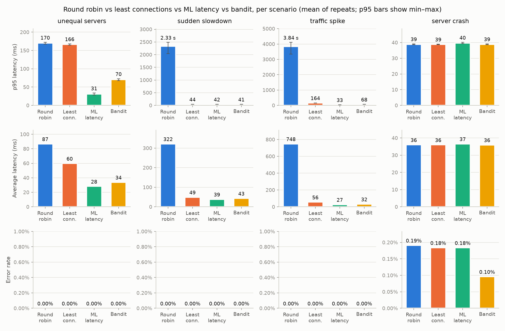
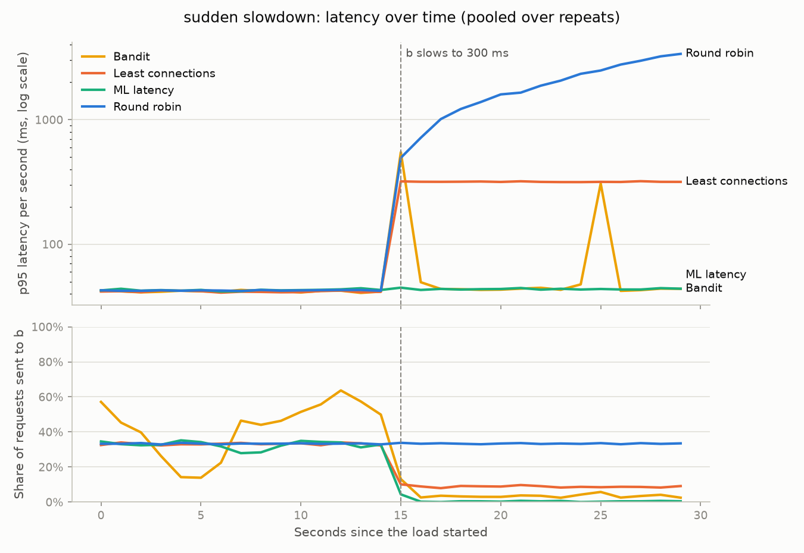

# adaptive-lb: an HTTP load balancer from raw sockets, with ML routing

A multithreaded HTTP/1.1 load balancer written from scratch in Python on raw `socket` and `threading` (no web framework, no proxy library), with health checks, circuit breakers, retries, rate limiting, connection pooling and a PostgreSQL request log. It routes with four interchangeable strategies: round robin, least connections, a supervised latency model (scikit-learn) and an epsilon-greedy bandit written by hand. An experiment harness compares all four under four traffic scenarios, and a Flask + Chart.js dashboard shows live traffic.

**Headline result (measured, 5 runs per cell):** when backends differ in speed, routing by predicted latency cut **p95 latency by ~80% compared with least connections** (166 → 31 ms with steady traffic, 164 → 33 ms during a 6× traffic spike) and by **82–99% compared with round robin**. When one backend suddenly became 10× slower, both adaptive strategies kept p95 near 42 ms while round robin's grew to 2.3 s, but plain least connections did just as well (44 ms), so ML added nothing there. With identical backends (the crash scenario) ML was slightly *worse* (39.6 vs 38.8 ms p95).

> Built as a learning project by a 2nd-year B.Tech student to show OS, computer networks, DBMS, system design and ML fundamentals in one working system. Every number in this README was measured on one laptop (Apple Silicon, 8 cores, macOS, Python 3.14) and comes with the command that produced it. [`CONCEPTS.md`](CONCEPTS.md) maps every feature to the concept behind it and ends with 20 interview questions this project answers.

**Contents:** [Architecture](#architecture) · [Features](#features) · [Run it](#run-it) · [Results](#results) · [Design decisions](#design-decisions-and-trade-offs) · [Limitations](#limitations) · [Future work](#future-work)

## Architecture



### One request, step by step

1. **Accept.** The listener thread's `accept()` returns a new connected socket (the kernel has already completed the TCP three-way handshake). It puts the socket into a **bounded queue**. If all 32 workers are busy and the queue is full, the listener blocks, new connections wait in the kernel's listen backlog, and overload costs latency instead of unbounded threads or memory.
2. **Parse.** A worker takes the socket and parses the HTTP/1.1 request by hand (`lb/http_parser.py`): request line, headers, then exactly `Content-Length` bytes of body. TCP is a byte stream, so it buffers until `\r\n\r\n`. Malformed or ambiguous requests (conflicting lengths, request-smuggling patterns) get a 400; a client too slow to send its whole request in 3 s gets a 408.
3. **Rate limit.** A token bucket per client IP allows bursts but caps the sustained rate; an empty bucket gets `429` with `Retry-After`.
4. **Choose a backend.** The router keeps only backends that the health checker says are up and whose circuit breaker is not open, then asks the configured strategy. The ML strategies run inside a guard: if the model is missing, a feature is unknown, prediction throws, or the decision takes over 2 ms, least connections decides instead and a warning is logged.
5. **Forward.** The proxy strips hop-by-hop headers, appends `X-Forwarded-For`, and sends the request over a **pooled keep-alive connection** to that backend (no new handshake per request), with connect and read timeouts. No answer: `502` (refused, reset, garbage) or `504` (too slow). `GET`/`HEAD` are retried on a different backend with exponential backoff; `POST` never is.
6. **Learn and reply.** The outcome updates the backend's in-flight count and latency average (read by least connections and the ML model), its circuit breaker, and the bandit's reward window. The response goes back to the client and the socket is closed with a lingering close, so a pending RST can't destroy the reply.
7. **Log.** The worker drops a record on the DB writer's queue (never blocking; if the queue is full the record is dropped and counted). The single writer thread inserts up to 200 records per transaction. The dashboard and the ML training export read that table through SQL views.

Running alongside: the health checker (every 2 s), the UDP heartbeat listener (each backend reports its CPU, memory and active connections every second), and the admin API, which adds or drains and removes backends at runtime.

## Features

**Operating systems**
- Producer-consumer with a hand-written **bounded queue** (one mutex, two condition variables) feeding a **fixed thread pool**, measured against thread-per-connection.
- **Readers-writers lock** with writer preference for the shared per-backend stats; a documented **global lock order** to rule out deadlock.
- **Graceful shutdown** on SIGINT/SIGTERM: stop accepting, drain in-flight requests, flush the DB queue. The signal handler only sets a flag.
- Survives file-descriptor exhaustion (`EMFILE` on `accept()`): log, back off, keep serving.
- Counting semaphore in the test backends to model limited capacity and queueing.

**Computer networks**
- **HTTP/1.1 parser and reverse proxy** on raw sockets: framing by `Content-Length`, chunked and close-delimited bodies, `Expect: 100-continue`, hop-by-hop headers, request-smuggling defences.
- **Connection pooling** with keep-alive and stale-connection detection (`MSG_PEEK`), measured against a new connection per request.
- **TCP and HTTP health checks**, **UDP heartbeats** with sequence numbers against reordering and duplicates, `502`/`503`/`504` semantics, lingering close (FIN vs RST), `TCP_NODELAY`.
- **Retries only for idempotent methods** (GET/HEAD) with exponential backoff.

**DBMS**
- 3NF PostgreSQL schema with foreign keys, CHECK constraints and soft deletes.
- **Single writer thread with batched transactions**: savepoint salvage of a bad row, reconnect with retry, and buffering through a database outage.
- **Composite indexes** proven with `EXPLAIN ANALYZE` on 1.2M rows (26–78× faster dashboard queries; a `LATERAL` "latest heartbeat before each request" join went from 10.8 s to 0.27 ms).
- **Views** for the dashboard and the ML export, `percentile_cont` for p95, `date_bin` for time buckets, and a batched 7-day **retention job**.

**System design**
- **Strategy pattern** for routing; **circuit breaker** (closed / open / half-open, state pattern); health-check hysteresis; **token-bucket rate limiting**; **rendezvous hashing** for sticky sessions.
- **Admin API** on a separate loopback port (control plane vs data plane), with drain-then-remove.
- **Open-loop load generator** (Poisson arrivals, no coordinated omission) and a repeatable **experiment harness**: fresh processes per run, identical seeds for every strategy, results computed in SQL.
- **Live dashboard** (Flask + Chart.js) combining Postgres history with the LB's in-memory state.

**Machine learning**
- **Supervised latency model**: features exported with SQL exactly as the LB knew them at decision time (no leakage), **time-based train/test split**, linear regression vs decision tree vs random forest vs a "recent average" baseline, MAE reported honestly.
- **Epsilon-greedy multi-armed bandit** written by hand, with a sliding window so it adapts when a backend changes.
- **Safe fallback** to least connections on a missing model, an error, or a blown 2 ms time budget, with every fallback counted. Per-decision overhead measured.

## Run it

You need Python 3.11+, Docker Desktop (with Compose v2) and `make`. Commands are given as `make` targets; each one is a single line in the [`Makefile`](Makefile) if you'd rather type it yourself.

```bash
git clone https://github.com/Bansil08/AI-Adaptive-Load-Balancer-.git adaptive-lb && cd adaptive-lb
make setup        # .venv with the pinned dependencies, and .env from .env.example (edit the password)
make up           # Postgres, three backends (20 / 60 / 150 ms) and the dashboard, in Docker; applies the schema
make test         # the full test suite (375 tests, under a minute)
```

**Watch it work** (three terminals):

```bash
make lb           # the load balancer on :8080 (round robin; change `strategy` in lb.toml)
make traffic      # 60 s of traffic at 50 req/s through it
open http://127.0.0.1:5050    # the dashboard: per-backend req/s and p95, health, circuit breakers, results
```

Try a failure while traffic flows: `docker compose stop backend-slow` (it goes down on the dashboard within ~4 s and traffic moves to the others), then `docker compose start backend-slow`. A single request: `curl -i localhost:8080/`. The admin API: `curl -s localhost:8081/backends`.

**Reproduce the results** (about an hour, unattended):

```bash
make baselines    # round robin + least connections on all scenarios (~13 min): the model's training data
make train        # export that data with SQL and train the model -> ml/models/latency_model.joblib
make experiments  # 4 strategies x 4 scenarios x 5 repeats, seed 2000 (~42 min) -> experiments/results/
```

The experiments start their own backends as local processes (ports 19001–19003), so the Docker backends can stay up or not. `make quick-experiment` is a one-minute version whose results go to `experiments/results/partial/`, so it never overwrites the committed ones. `make help` lists every target. To stop everything: `make down` (the data stays in a Docker volume; `docker compose down -v` deletes it).

<details>
<summary>Other measurements and tools</summary>

| Command | What it measures | Report |
|---|---|---|
| `python -m experiments.benchmark_concurrency` (~25 min) | thread pool vs thread-per-connection | `experiments/results/concurrency_benchmark.md` |
| `python -m experiments.benchmark_pooling` (~5 min) | connection pooling vs a new connection per request | `experiments/results/pooling_benchmark.md` |
| `python -m experiments.demo_failover` (~45 s) | kill and restart a backend under traffic, retries off / on | `experiments/results/failover_demo.md` |
| `python -m experiments.benchmark_db` (~5 min) | batched inserts, `EXPLAIN ANALYZE` with / without indexes, retention | `experiments/results/db_benchmark.md` |
| `python -m ml.evaluate --data <csv>` | model MAE on unseen runs, per-decision overhead | `experiments/results/ml_inference.md` |
| `python scripts/retention.py` | deletes rows older than 7 days, 5000 per transaction (run it from cron) | |

Every feature is configured in [`lb.toml`](lb.toml), with a comment on each setting: strategy, sticky sessions, timeouts, pool size, health-check and circuit-breaker thresholds, retries, rate limit, heartbeat and admin ports, DB batching, ML time budget and bandit epsilon.

</details>

## Results

Final batch `comparison-20261022T212032Z`: every strategy on every scenario, **5 runs of 30 s each per cell** (80 runs), seeds 2000–2004, which the model never trained on. Every strategy got the same seeds, so it saw the identical sequence of request arrivals. Each run started fresh backends and a fresh LB. Latency is measured by the LB and computed in SQL; on all 80 runs the logged request count matched the load generator's exactly. Retries were off so that errors show what the routing did. Cells are **mean ± standard deviation over the 5 runs**. Full report with min–max and per-backend shares: [`experiments/results/comparison_results.md`](experiments/results/comparison_results.md). Command: `make experiments`.

| Scenario | Strategy | p95 latency (ms) | Avg latency (ms) | Errors | Throughput (req/s) | Requests sent to each backend |
|---|---|---:|---:|---:|---:|---|
| **Unequal servers**<br>20 / 60 / 150 ms backends, 90 req/s | Round robin | 170.0 ± 2.2 | 86.8 ± 1.5 | 0% | 90.2 | 33 / 33 / 33% |
| | Least connections | 166.3 ± 1.9 | 59.8 ± 2.0 | 0% | 90.3 | 56 / 29 / 15% |
| | **ML latency** | **31.3 ± 2.6** | **28.2 ± 1.4** | 0% | 90.6 | 99 / 1 / 0% |
| | Bandit | 70.4 ± 2.0 | 33.8 ± 1.6 | 0% | 90.5 | 93 / 3 / 4% |
| **Sudden slowdown**<br>3 × 30 ms; b → 300 ms at 15 s | Round robin | 2,333 ± 175 | 321.8 ± 20.3 | 0% | 81.7 | 33 / 33 / 33% |
| | Least connections | 43.6 ± 2.5 | 49.3 ± 1.2 | 0% | 90.3 | 40 / 21 / 39% |
| | ML latency | 41.9 ± 2.1 | **38.6 ± 1.2** | 0% | 90.5 | 41 / 17 / 42% |
| | Bandit | 41.5 ± 1.6 | 43.3 ± 2.4 | 0% | 90.4 | 36 / 23 / 41% |
| **Traffic spike**<br>unequal; 30 → 180 req/s at 10 s | Round robin | 3,840 ± 338 | 748.2 ± 65.5 | 0% | 113.8 | 33 / 33 / 33% |
| | Least connections | 164.0 ± 0.3 | 55.7 ± 0.3 | 0% | 130.0 | 59 / 28 / 14% |
| | **ML latency** | **33.2 ± 2.5** | **26.9 ± 0.6** | 0% | 130.4 | 99 / 0 / 0% |
| | Bandit | 68.0 ± 1.0 | 32.0 ± 0.6 | 0% | 130.3 | 93 / 3 / 4% |
| **Server crash**<br>3 × 30 ms; b killed at 15 s | Round robin | 38.9 ± 0.2 | 36.0 ± 0.1 | 0.19% | 90.3 | 42 / 17 / 42% |
| | Least connections | 38.8 ± 0.1 | 36.0 ± 0.1 | 0.18% | 90.4 | 42 / 17 / 42% |
| | ML latency | 39.6 ± 0.3 | 36.6 ± 0.2 | 0.18% | 90.3 | 42 / 17 / 42% |
| | Bandit | 38.9 ± 0.2 | 36.0 ± 0.1 | 0.10% | 90.4 | 34 / 21 / 45% |





### What the numbers say, including where ML did not help

- **Round robin fails whenever a backend can't keep up with its third of the traffic.** After b slows to 300 ms it can finish ~25 req/s but keeps getting 30, so its queue grows for the rest of the run: p95 climbs from 40 ms to 2.3 s (the blue line above). In the spike, the slow backend's third (60 req/s) exceeds its ~51 req/s capacity: p95 reaches 3.8 s, and throughput drops 13% (113.8 vs 130 req/s) because the backlog takes extra seconds to drain. Every other strategy avoids both.
- **Least connections already captures most of the gain.** Watching in-flight counts (Little's law: a slower backend holds its requests longer) is enough to cut the slowed backend's share to ~9% within a second. In the slowdown it is within noise of both ML strategies (43.6 ± 2.5 vs 41.9 ± 2.1 ms p95). Its blind spot is speed: with unequal backends it still sends the 150 ms server 14–15% of requests, more than 5%, so the p95 *is* a slow-server answer (~165 ms).
- **ML wins where backends differ in speed.** The latency model sends 99% of traffic to the 20 ms backend, which can serve ~380 req/s, so even 180 req/s doesn't overload it. p95 falls from ~165 to 31–33 ms, about −80%. The bandit gets halfway (68–70 ms). Its ε = 0.1 exploration permanently sends 3–4% to *each* slower backend, and since those 7% of requests are slow, they land in the top 5% and set the p95. That is the cost of being able to notice change. In the slowdown timeline the same exploration shows as brief spikes: in any second where 5 or more of ~90 requests randomly land on b, that second's p95 is a 300 ms answer.
- **ML did not help in two scenarios.** In the **slowdown** the gain over least connections (~2 ms p95) is smaller than the run-to-run spread; only the average improves (38.6 vs 49.3 ms), because ML cuts b to under 1% instead of ~9%. In the **crash**, with identical backends there is nothing to learn: ML's p95 is ~0.8 ms *worse* than round robin's, from its extra per-decision work and fallbacks. Errors (~0.2%) are the requests in flight on b when it died, or sent to it before the circuit breaker and health checks removed it. The bandit's lower 0.10% is chance: fewer of its requests happened to be in flight on b at that instant. It is not a designed advantage.
- **Why ML wins is less impressive than it looks.** The model's weights amount to "1 × recent average latency + ~3 ms per request in flight", and for normal requests it predicts no better than simply using the recent average (MAE 6.1 vs 3.3 ms under 200 ms; [`ml_training.md`](experiments/results/ml_training.md)). The gain comes from routing on *latency* rather than on load, which a non-ML rule could probably do too. That baseline was not measured, so it is the first item under Future work. The CPU and memory features added nothing (22.5 vs 22.6 ms test MAE without them), because every backend here is the same sleeping Python process.
- **Costs.** One ML routing decision takes ~34 µs vs ~4 µs for least connections ([`ml_inference.md`](experiments/results/ml_inference.md)). 510 of 60,390 ML-routed requests (0.84%) fell back to least connections. 284 of those were at the start of a run or on a killed backend (no fresh heartbeat or no latency history yet). The other 226 went over the 2 ms budget, because a thread was waiting for Python's GIL while other workers ran, not because the model was slow. The bandit fell back once in 20 runs.
- **Caveats.** The model was trained on earlier runs of these same four scenarios (Phase 5 baselines, seeds 42–44), so this is its best case. It never explores, so a backend it stops using keeps its old average and a recovery would go unnoticed. Everything ran on one laptop with artificial delays.

### Other measured results

- **Thread pool vs thread-per-connection** (50 ms backends): at 200 concurrent clients a 256-worker pool served 3,426 req/s with 257 threads, thread-per-connection 3,378 req/s with 201. At 500 clients thread-per-connection was ~9% faster (4,652 vs 4,276 req/s) but needed 437 threads against the pool's fixed 257. A 32-worker pool capped out at ~560 req/s. The pool's benefit is a hard cap on threads, not speed.
- **Connection pooling** (0 ms backends, loopback): +29–35% throughput (e.g. 7,273 vs 5,514 req/s at 8 clients) and 0.5 instead of 1,000 backend TCP handshakes per 1,000 requests; TIME_WAIT sockets on the backend ports dropped from ~14,800 to ~53.
- **Failover**: a backend SIGKILLed under ~160 req/s. With retries off, 3 of 3,156 requests failed, all in the first second. With retries on, none of 3,167 did. The restarted backend was serving again 1 s after it came back.
- **Database**: batching 200 rows per transaction inserted 52,512 rows/s against 3,060 for one commit per row (17×). With Postgres stopped for 6 s under ~1,000 req/s, clients saw no errors and no slowdown, and all 20,010 requests still reached the table once it came back.

## Design decisions and trade-offs

**Thread pool instead of asyncio or thread-per-connection.** The project's point is to show the OS mechanisms (a bounded buffer, condition variables, a readers-writers lock), which `asyncio` hides. Against thread-per-connection, a fixed pool puts a hard bound on threads and memory under overload and pushes back through the kernel's listen backlog. The measured cost: each worker is tied up for the whole request, so a slow client or slow backend occupies a thread. At 500 clients thread-per-connection was 9% faster, and enough slow clients (slowloris) can stall the pool for a few seconds. `select`/`epoll` would fix that and is deliberately left out to stay at undergraduate-syllabus level.

**UDP for heartbeats, TCP for requests.** A heartbeat is a "latest value" report sent every second: if one is lost, the next replaces it, so TCP's handshake, retransmission and in-order delivery would only add cost, and a stalled TCP stream would deliver stale metrics late. Each datagram carries the agent's start time and a sequence number, so reordered or duplicated ones are dropped. A proxied request is the opposite case (every byte must arrive once, in order), so it uses TCP. The cost: UDP is trivially spoofable, so the listener binds to loopback and accepts reports only for known backends. A real deployment would sign them.

**One database writer thread with batching.** If 32 workers each inserted their own row, every request would wait on a database round trip and a commit (fsync), and 32 connections would contend for the database. Instead workers do a non-blocking `put()` and one thread writes batches of up to 200 rows per transaction: 17× the insert rate. A slow or down database never slows requests, because the queue absorbs the gap. The trade-offs: a crash of the LB loses whatever is still queued in memory, and when the queue is full (10,000 records, ~10 s of a database outage at 1,000 req/s), records are dropped and counted rather than blocking traffic. Request serving matters more than logging completeness. A failed batch is retried, so delivery is at-least-once (a retry after a lost commit acknowledgement can insert a batch twice).

**Retries only for GET and HEAD.** A retry is only safe if doing the request twice has the same effect as doing it once. If a POST's connection breaks after the backend received it, the backend may already have acted (charged a card, placed an order), and resending it would do that twice. GET and HEAD are read-only by definition, so they are retried on a *different* backend with exponential backoff, to avoid a retry storm on a struggling cluster. Only failures with no usable answer are retried: a 500 is the backend's answer and is passed through. (PUT and DELETE are idempotent too; they're left out to keep the rule simple.) The retry budget is capped at 2, so one request can't multiply load by more than 3×.

**Others.** A circuit breaker (passive, from real traffic) *and* health checks (active probes): the breaker reacts within a few failed requests, while probes notice a dead backend that gets no traffic and confirm when it has recovered. Results are computed in SQL from the request log, not from the load generator, and cross-checked against it on every run (every run matched exactly). The ML model is trained offline and only loaded by the LB, so a training bug can never take routing down: the guard falls back to least connections.

## Limitations

**The load balancer is a single point of failure.** Everything goes through one process on one machine. If it crashes, every backend is unreachable, however healthy they are, and its in-memory state (circuit breakers, stats, the bandit's learned rewards, queued log records) is lost.

The standard fix is **active-passive failover**:
- Run a second, identical LB as a hot standby on another machine. Both have the same config and both health-check the backends, so the standby's view of the backends is already warm.
- Clients connect to a **virtual IP**, not to either machine. The active LB owns it and sends a heartbeat to the standby every ~1 s (VRRP, as implemented by `keepalived`, does exactly this).
- If the standby misses N heartbeats in a row (the same hysteresis idea as the health checks), it claims the virtual IP and announces it with a gratuitous ARP, so traffic moves to it within a few seconds. Connections in flight on the dead LB are lost, and clients retry.
- The hard part is **split brain**: if only the link between the two LBs fails, both think the other is dead and both take the virtual IP. Fencing (the new active one cuts off the old one, e.g. through the switch or a cloud API) or a third tie-breaking node prevents it.
- Most state can stay local, since each LB re-learns backend health in seconds. Rate-limit buckets and sticky sessions would need shared storage (e.g. Redis) or rebuilding after failover.

Active-active (DNS round robin or anycast in front of several LBs) also scales out, but every piece of shared state then needs coordination, which is beyond this project's scope.

**Other limitations, honestly:**
- One request per client connection (no client-side keep-alive), and no TLS: the LB speaks plain HTTP.
- Each request ties up a worker thread, so slow clients can tie up the pool (see the thread-pool trade-off above).
- Python's GIL means threads don't run Python code in parallel. This is fine for an I/O-bound proxy, but it also caused most of the ML strategy's over-budget fallbacks.
- The admin API and heartbeats are unauthenticated and bound to loopback.
- Every backend is a local process sleeping for an artificial delay, so the CPU and memory heartbeat features carry no real signal, and every experiment runs on one laptop: the LB, backends, load generator and Postgres all share 8 cores.
- The latency model was trained on earlier runs of the same four scenarios (with different random seeds), which is its best case.

## Future work

- **A non-ML latency baseline**: route to the lowest "recent average + k × in-flight" score. The model's weights are close to exactly that, so this is the obvious test of whether the ML adds anything.
- **Active-passive LB pair** with a virtual IP, as described above.
- **ML that explores**: the supervised strategy never re-tries a backend it has stopped using, so it can't notice a recovery. Mixing in a little exploration (or retraining online from the request log) would fix that. A bandit with UCB or Thompson sampling instead of a fixed ε would explore less once it is confident.
- **Event-driven I/O** (`selectors`) for the client side, so slow clients stop costing a thread each; client keep-alive; TLS termination.
- **Realistic backends**: real CPU-bound work and Docker CPU limits, so CPU and memory carry signal, and runs across several machines.
- Authenticated heartbeats (HMAC) and an authenticated admin API.

## Repository layout

| Path | What's there |
|------|--------------|
| `lb/` | The load balancer: listener + thread pool (`server.py`), HTTP parser, proxy, router, strategies, health checks, circuit breaker, heartbeats, rate limiter, connection pool, DB writer, admin API |
| `backend/` | Test backend (configurable delay, jitter, capacity) and its UDP heartbeat agent |
| `db/` | `schema.sql` (3NF tables, indexes) and `queries.sql` (views for the dashboard and the ML export) |
| `ml/` | `export_data.py` (SQL → features), `train.py` (time split, four models, MAE), `evaluate.py` (unseen runs, overhead) |
| `experiments/` | Load generator, scenarios, experiment runner, plots, benchmarks; `results/` holds the measured reports and charts |
| `dashboard/` | Flask app, Chart.js page |
| `scripts/` | `init_db.py` (apply the schema), `retention.py`, `seed_db.py` (synthetic data for the DB benchmark) |
| `tests/` | pytest suite: unit tests plus tests against a throwaway Postgres database |
| `CONCEPTS.md` | Feature → file → CS concept map, lock order, `EXPLAIN ANALYZE` before/after, interview questions |
| `PROJECT_SPEC.md`, `phase-*.md` | The original specification and the instructions for each build phase |
